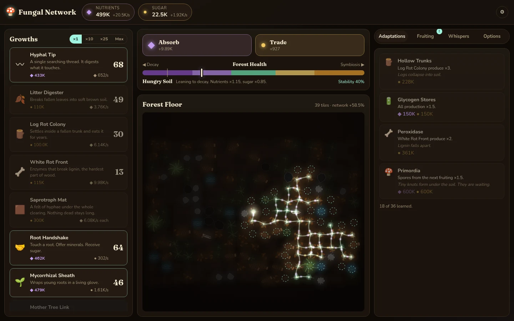
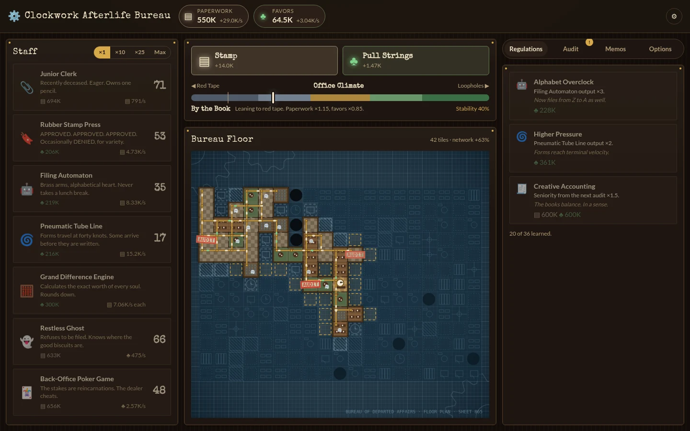
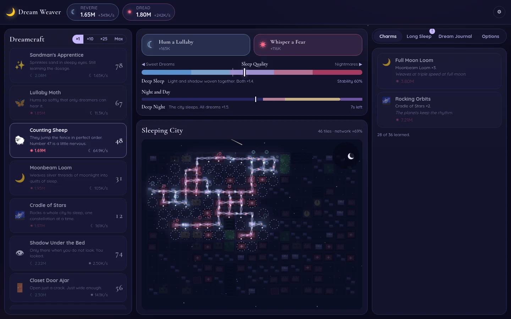

<div align="center">

# Underneath

**An idle game about hidden worlds that keep working while nobody watches.**

[](https://mundaplus.github.io/Underneath/)

[](LICENSE)




</div>

## About

Underneath is an incremental (idle) game engine with plug-in themes. Each theme uses the same rules but has its own world, text and art. Three themes are ready:

| Theme | What you do |
|---|---|
| 🍄 **Fungal Network** | You are a mycelium under a forest floor |
| ⚙️ **Clockwork Afterlife Bureau** | You run the paperwork office of the underworld |
| 🌙 **Dream Weaver** | You harvest the dreams of a sleeping city, by night |

Play it at **https://mundaplus.github.io/Underneath/** on a PC or a phone. No account and no install. The game saves in your browser.

## Features

- **Two resources in balance.** Two resources pull against each other. Their ratio puts you in a zone with bonuses or penalties.
- **A map to claim.** Claim tiles next to your network. Special terrain gives bonuses or unlocks generators.
- **Generators and upgrades.** Generators produce every second. Upgrades multiply production, make clicks stronger or make tiles cheaper.
- **Prestige.** Reset the run for a permanent currency and spend it in a shop. Each run gets a new random map.
- **Time cycle.** A theme can add a repeating cycle, such as night and day, that changes production.
- **Offline progress.** The game calculates up to 8 hours of progress while you are away. It saves every 15 seconds.
- **Plug-in themes.** A theme is content, a renderer and CSS. The engine does not change.

## Screenshots

| Clockwork Afterlife Bureau | Dream Weaver |
|---|---|
|  |  |

Pick the theme in **Options**, or open the game with `?theme=clockwork` or `?theme=dream`. Each theme has its own save.

<details>
<summary><b>Theme details</b></summary>

### Fungal Network

| Engine term | Fungal Network |
|---|---|
| Resources | Nutrients (decay), Sugar (symbiosis), Spores (prestige) |
| Generators | Growths: Hyphal Tip … Saprotroph Mat (decay), Root Handshake … Ancient Grove Pact (symbiosis) |
| Balance | Forest Health: Rot Bloom, Hungry Soil, Harmony, Lush Canopy, Starved Ground |
| Map | Forest Floor: leaf litter, fallen logs, oak roots, Mother Trees, streams, stone, bedrock |
| Prestige | Fruiting: release spores into a new forest |

Decay growths cost sugar, and symbiosis growths cost nutrients. You need both sides.

### Clockwork Afterlife Bureau

| Engine term | Clockwork Afterlife Bureau |
|---|---|
| Resources | Paperwork (order), Favors (chaos), Seniority (prestige) |
| Generators | Staff: Junior Clerk … Grand Difference Engine (order), Restless Ghost … Department of Exceptions (chaos) |
| Balance | Office Climate: Total Paralysis, By the Book, Running Like Clockwork, Lax Oversight, Ghostly Anarchy |
| Map | Bureau Floor, drawn as a blueprint: desk pools, filing rooms, break rooms, back rooms, Forbidden Archives, Great Clock Rooms, tube junctions, walls, the Void |
| Prestige | Audit: move to a new building with more seniority |

### Dream Weaver

| Engine term | Dream Weaver |
|---|---|
| Resources | Reverie (sweet dreams), Dread (nightmares), Lucidity (prestige) |
| Generators | Dreamcraft: Sandman's Apprentice … Cradle of Stars (sweet), Shadow Under the Bed … The Recurring Nightmare (dark) |
| Balance | Sleep Quality: Saccharine Haze, Pleasant Drift, Deep Sleep, Restless Night, Night Terrors |
| Cycle | Night and Day, 4 minutes: Deep Night ×1.5, Dawn, Daytime ×0.5, Dusk |
| Map | Sleeping City: cottages, nurseries, tenements, night wards, haunted houses, observatories, parks, smokestacks, the Black River |
| Prestige | Long Sleep: wake in a bigger city, more lucid |

</details>

## Getting started

You need [Node.js](https://nodejs.org/) 20.19 or newer.

```bash
git clone https://github.com/MundaPlus/Underneath.git
cd Underneath
npm install
npm run dev
```

Then open http://localhost:5180.

| Command | What it does |
|---|---|
| `npm run dev` | Starts the dev server on port 5180, also on the LAN |
| `npm run build` | Writes static files to `dist/`. Any web server can host them. |
| `npm test` | Runs the engine unit tests (Vitest) |
| `npm run sim -- fungal 2 75` | Runs a headless bot to check pacing: theme, clicks per second, minutes |

## Project structure

```
src/engine/      theme-neutral rules: types, game, map, save, format
src/ui/          DOM interface and base layout (CSS tokens only)
src/themes/      theme registry, theme contract, shared renderers
  fungal/        Fungal Network: content, renderer, CSS
  clockwork/     Clockwork Afterlife Bureau: content, renderer, CSS
  dream/         Dream Weaver: content, renderer, CSS
scripts/         simulate.ts, the headless pacing bot
docs/THEMES.md   how to add a theme
```

## Add a theme

A new theme needs content, a renderer and a stylesheet. Read [docs/THEMES.md](docs/THEMES.md) for the steps.

## Deployment

Each push to `master` runs the tests, builds the game and publishes `dist/` to GitHub Pages ([`.github/workflows/pages.yml`](.github/workflows/pages.yml)).

## Credits

Made by Munda Plus — https://munda.si

## License

MIT. See [LICENSE](LICENSE).
